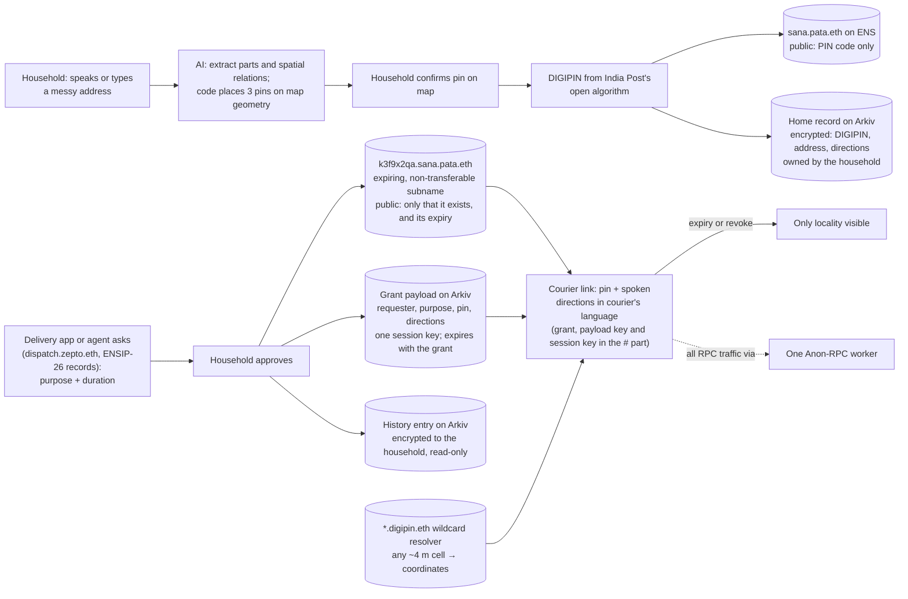

# Pata for ETHGlobal Mumbai

Picked 2026-10-22, replacing Price Witness · Updated 2026-11-01: Arkiv replaces Hedera as the third pick, and the plan was stress-tested from the judges' side ([below](#stress-test-the-judges-view)) · Updated 2026-11-03: the research in [docs/research/](docs/research/README.md) is folded in (hosting, grant expiry, Arkiv lifetimes, the Anon-RPC bootstrap, what each third party sees) · Updated 2026-11-04: the design grilling settled the records, keys, grants, courier link, server and AI pipeline ([GLOSSARY.md](GLOSSARY.md), [docs/adr/](docs/adr/)) · Track: Classic "From Scratch" · Sponsor prizes: ENS (Best Use of ENSv2), Ethereum Foundation (Best Use of Anon-RPC or Best CROPS App), Arkiv (Build on Arkiv, from scratch) · Also used for: none yet · Alternatives: Rider Ledger and Price Witness (written up outside this repo)

*Pata* is Hindi for "address". India Post's new DIGIPIN gives every square of about 4 m in India a code, and its DHRUVA plan wants UPI-style address handles that apps can use only with consent. Pata builds that on ENS:
- a household owns `name.pata.eth`;
- AI turns its messy landmark address into an exact pin and spoken directions;
- each courier or ambulance gets an expiring, revocable key to the exact door, while everyone else sees only the locality.

Facts about the event itself are in [research.md](research.md).

## Why this one, after the first two

- **A different field:** addressing, delivery and emergency access, not money or scams.
- **Built on things that already work:**
  - DIGIPIN, India's open national grid ([India Post](https://www.indiapost.gov.in/digipin));
  - the government's own consent design for addresses ([DHRUVA policy, May 2025](https://www.indiapost.gov.in/documents/offerings/intiatives/IP_30052025_Digipin_English.pdf));
  - the features ENSv2 just shipped.
  
  It follows the ETHPark-QR pattern: crypto quietly placed under a national standard people already use.
- **Not crowded:** no ETHGlobal project uses DIGIPIN or physical home addresses (see [Freshness check](#freshness-check)). ENS entries will mostly be "AI agents as namespaces", so a real-world use stands out.
- **Value from the first user:** a household can share a link today, without couriers, apps or the government adopting anything. The faster way in is through sellers, at the WhatsApp address check they already pay for.
- **Why now:** India's rule for consent managers comes into force on **13 Nov 2026**, six days after the hackathon. Consent managers are the registered platforms through which people "give, manage, review and withdraw" consent ([DPDP Act, s. 2(g)](https://www.meity.gov.in/static/uploads/2024/06/2bf1f0e9f04e6fb4f8fef35e82c42aa5.pdf)). Rule 4 starts "one year after the date of publication" ([DPDP Rules 2025, r. 1(3)](https://spiceroutelegal.com/publications/digital-personal-data-protection-dpdp-rules-2025/)), and the Rules were notified in November 2025 ([PIB](https://www.pib.gov.in/PressReleasePage.aspx?PRID=2190014)). Pata's grants are that kind of consent record, for addresses.

## The six jury questions

| Question | Answer |
|---|---|
| What real problem? | **Sana** (persona) lives in a Dharavi lane near the venue. The written address ("Room 14, Chawl 3, near Hanuman Mandir, 90 Feet Road") gets couriers and ambulances lost in the last 50 metres. So Sana sends a WhatsApp location pin and a phone number to every app and courier, and they all keep it forever. Those copies leak. In Domino's India's 2021 breach, 22.5 million customers' email addresses went up for sale, with their names, phone numbers, order histories and physical addresses ([Have I Been Pwned](https://haveibeenpwned.com/Breach/DominosIndia)). With Pata she stops typing her address into each app's database: the app gets an expiring grant to her current door instead of keeping its own copy. **Her payoff:** fewer "where are you?" calls from lost couriers, one screen showing who can find her door right now, and an address that stops piling up in app databases. Poor addressing costs India an estimated **$10–14 billion a year, about 0.5% of GDP** (Rustogi et al., 2018, cited in [DHRUVA](https://www.indiapost.gov.in/documents/offerings/intiatives/IP_30052025_Digipin_English.pdf)). India Post's DHRUVA policy proposes name@entity address labels and **time-bound, revocable consent tokens**, so an app gets your address only for a purpose and only for a while ([PIB, May 2025](https://www.pib.gov.in/PressReleasePage.aspx?PRID=2132858)). It's still a policy paper; we found no working version where the household owns its label. |
| Why does it need AI? | **Its main job is the last 50 metres.** Households describe the way in landmarks, not coordinates: "opposite the Ganesh temple, third lane, blue gate". They say it in Hindi, Marathi, English or a mix, often aloud. The AI turns those words into directions a courier can follow in *the courier's* language, read aloud, so a Marathi-speaking household can guide a Hindi-speaking courier. **Its second job is drafting the pin** from the same words, because DIGIPIN only works once there are coordinates. That needs language understanding plus reasoning over nearby landmarks on a map. Anyone who can use a map can skip it and drop the pin by hand. |
| Why this model and architecture? | **Models:** Claude, using OpenStreetMap search (Nominatim) and landmark lookup (Overpass) as tools. Haiku 5.5 first extracts the address parts, including the locality and PIN code. That locality's bounding box then limits every map search to the neighbourhood, so a "Hanuman Mandir" across the city can't win. A larger model ranks the candidate landmarks inside the box and picks landmarks only from the OpenStreetMap results our code fetched, naming each one's relation to the door: "at", "opposite", "behind" or "near" ("third lane after" needs lane counting that Dharavi's map often lacks, so it's P2). Plain code then applies those relations to OpenStreetMap's street geometry to place the three candidate pins, so distances come from the map, not the model. Speech-to-text and text-to-speech handle Hindi and Marathi. The DIGIPIN itself comes from India Post's open algorithm, never from the model. **What the model sees:** the household answers in two parts. How people find the place is spoken, and goes to the model; the map search gets only the landmark names and locality the model pulls out of it, never the spoken words. The flat or room number is typed, and never leaves the phone except inside encrypted records. **Architecture:** DHRUVA's roles mapped onto ENSv2. • **Central Mapper → the ENS hierarchy.** `pata.eth` runs its own ENSv2 subname registry as one Address Information Provider. Anyone else can run another, so there's no single operator. • **Digital Address → a household subname**, such as `sana.pata.eth`. It's owned by the household key, derived from its passkey from P1 (in P0, a key kept on the phone), and uses the household's own Permissioned Resolver. Its ENS records are public and hold only the locality (PIN code). The exact DIGIPIN, written address and directions are an encrypted Arkiv entity that the household owns. The directions audio, one clip each in Hindi, Marathi and English, is made once at setup and kept as separate encrypted entities. It's set up as a "forever" name the parent can't take back: `pata.eth`'s registry, which holds `sana`, is emancipated, and `pata.eth`'s subregistry pointer is locked. Each household also gets its own small registry for its grants, so only the household can issue or revoke them; in a shared registry, the provider could issue grants for anyone. That grant registry stays un-emancipated, because the household's revoke role is one of the roles emancipation gives up. • **Consent token → an expiring, non-transferable subname with an opaque label**, such as `k3f9x2qa.sana.pata.eth`. ENS writes every label and record value into public event logs forever, so the grant itself shows only that it exists and when it ends. It's minted to a one-time address derived from the grant's session key, with no roles beyond ownership. Whoever holds the courier link can prove it holds a live grant, but can't transfer the grant or hang anything off it. The grant's label comes from the same session key. In P2 a requester can supply its own address instead. Everything else is inside the **payload**: the requester, the purpose, and the pin, address and directions in the requester's language. The payload is an Arkiv entity owned by the household that expires at the same moment as the grant, encrypted with a fresh **session key for that grant only**. The household name, the payload's key and the session key reach the requester in the `#` part of a courier link, `/c#1~sana.pata.eth~<payload key>~<session key>`, which browsers never send to a server. The consent hand-off carries the same string. The link is a bearer secret: anyone who sees it holds the grant, and the consent screen says so. No requester's long-term key is used, so nothing stored can be opened later with a retained or stolen company key. On expiry the subname's owner and resolver read as zero, and the payload leaves Arkiv. Resolution doesn't fail by itself: the Universal Resolver falls back to the nearest ancestor's resolver, the household's own. So the courier view checks the grant in ENS first (its owner must be the address derived from the session key) and treats an expired grant, or a missing payload, as gone. ENS is the public proof of consent and the switch honest clients obey, not cryptographic enforcement: a grant holder can read a live payload straight from Arkiv, and keeps whatever it read. The household can also revoke a grant at any time: deleting the payload takes one 2-second Arkiv block, and unregistering the subname takes one Sepolia block (unregistering an already-expired grant reverts, so the app checks its status first). Either way the app wipes the session key. Chain history still holds the old ciphertext, which only that grant's key can open. • **The public grid → wildcard resolution.** `39j49ll8t4.digipin.eth` resolves any cell of India Post's grid, each about 4 m across, to its coordinates without registering anything; the resolver contract decodes DIGIPIN itself. This is public data with no person attached. • **Families and flatmates → record aliasing:** several people's names point at one home record. • **Private lookups → Anon-RPC:** all of the app's RPC traffic, on Sepolia and on Arkiv, goes through one long-lived Anon-RPC worker, Nox, whose specifier contract is on Sepolia and which reaches Arkiv too, so no RPC provider can see whose address a courier app is resolving. • **Requesters → ENS names:** each delivery app, ambulance service or AI agent has its own name, for example `dispatch.zepto.eth`. Each name publishes the agent records `agent-context` and `agent-endpoint[web]` ([ENSIP-26](https://docs.ens.domains/ensip/26/), still a draft; the endpoint key carries its protocol in brackets). The consent screen shows the first, and the hand-off goes over TLS to the second. |
| What happens when AI is wrong? | **The AI only proposes.** It shows the top 3 candidate pins, each with the landmark it relied on and a confidence of low, medium or high (the model's own numbers aren't calibrated), and the household confirms or drags the pin on a map before anything is saved. **Disagreement triggers a fallback:** if the top two pins are more than 50 m apart, or more than one place in the locality has the landmark's name, the app says "we're not sure" and asks the household to pick one or drop the pin by hand. If no landmark is found at all, the map opens on the locality for a hand-dropped pin. Code rejects any landmark that isn't in the OpenStreetMap results it fetched. There's no gate-photo step: the model sees only the spoken way to the door. **Directions are rebuilt** from the confirmed pin, never from the original guess, and a courier can send a voice note back if they're still lost. **Dates and codes are deterministic:** expiry times and DIGIPIN encoding are plain code. **Emergencies:** an ambulance grant always shows the exact pin, even if the written directions failed. |
| Can it scale? | DHRUVA envisions many public and private Address Information Providers and Agents ([DHRUVA](https://www.indiapost.gov.in/documents/offerings/intiatives/IP_30052025_Digipin_English.pdf)), so Pata can be one of them rather than a rival. **Free for households,** including renters and migrant workers who move often: the name stays when they move, and only the pin changes. **Paying users** (DHRUVA calls them Address Information Users): • logistics and quick-commerce firms, which lose money on slow and failed last-mile deliveries. About 26% of India's cash-on-delivery orders are returned to origin, and incorrect addresses are a primary cause ([Amazon Shipping](https://shipping.amazon.in/blog/what-is-rto-how-to-reduce-return-to-origin), citing Shipway's FY25 data); • banks and insurers verifying an address with consent; • emergency and welfare services, including rescuers in a flood, when a stranded household can give them a short grant to the exact door. They would pay a small fee per consented lookup, and each grant leaves a tamper-evident record: a timestamped subname held by the requester until it expires. That record matters because India's data protection law puts the burden of proving consent on the company ([DPDP Act, s. 6(10)](https://www.meity.gov.in/static/uploads/2024/06/2bf1f0e9f04e6fb4f8fef35e82c42aa5.pdf)). Each household costs one subname and a few Arkiv entities, with gas paid by our relay so they never see it. **Grants are per relationship, not per parcel:** Sana approves a seller once, for a month, and can revoke at any time. So a household writes a few transactions a year, not one per delivery. **Managed or sovereign names:** most households could simply be records in a provider's resolver, which ENSv2 supports without a contract per name ([ENS docs](https://docs.ens.domains/ensv2/subnames)). Households that want a name no provider can touch get it in an emancipated registry, as in the demo, while their own grant registry stays revocable by them. **The market already pays for this step:** sellers pay Shiprocket Engage ₹2.49 an order to confirm orders and addresses on WhatsApp ([Shopify listing](https://apps.shopify.com/shiprocket-engage)). GoKwik's Kwik Pass pre-fills verified addresses for returning shoppers across its network ([GoKwik](https://www.gokwik.co/blog/how-to-reduce-rto-in-e-commerce)): a shared address network that one company runs. Pata is the version the household owns. |
| Great demo vs impact? | Three moments. **Speak once:** Sana describes the way to her door in Marathi, with her room number typed so it never leaves the phone. Three candidate pins appear with the landmark each relied on. She fixes the one that's off, and `sana.pata.eth` is created. **The key that dies:** a seller's confirmation asks for her address for a delivery. The courier's link opens with directions spoken in Hindi, the courier's language. The grant, shortened to 20 seconds, expires on stage: the link now shows only "Dharavi, 400017", and her "who can find my door" list empties by itself. **A trillion names:** any of India Post's 1.1 trillion grid cells resolves as an ENS name with nothing registered, while a stranger looking up `sana.pata.eth` sees only the locality. **The metric:** how many of 20 test addresses the AI placed within 25 m before the household corrected anything. |

## How it fits this hackathon

ETHGlobal judges on five criteria ([hacker guide](https://ethglobal.com/events/mumbai/info/details)):

- **Technicality:**
  - consent as expiring, revocable ENS names, with each grant's payload under its own session key;
  - a wildcard resolver that decodes DIGIPIN on-chain;
  - record aliasing for shared homes;
  - all RPC traffic through Anon-RPC;
  - household-owned, expiring payloads and history on Arkiv;
  - an AI that reasons over map landmarks.
- **Originality:** the first user-owned version of India's DHRUVA design, and the first ETHGlobal project on DIGIPIN.
- **Practicality:** a household can use it today by sharing one link, and sellers can adopt it at the WhatsApp address check they already pay for.
- **Usability:** speak the way to your door, confirm a pin, approve a request. Passkey sign-in, gas paid for you, no crypto words, and one screen that answers "who can find my door right now?".
- **WOW factor:** three moments:
  - Marathi in, Hindi out;
  - a courier's access dying live on stage while Sana's live-access list empties;
  - India Post's whole grid, 1.1 trillion cells, resolving as ENS names with nothing registered.

**The sponsor tech is genuine, not bolted on:**

- **ENSv2:** the product *is* a naming system with owners, permissions and expiry. Remove ENS and you'd have to rebuild a central registry, the single point of control that DHRUVA's own design avoids by calling for a federated system.
- **Anon-RPC:** looking up someone's address is sensitive, so lookups shouldn't leak to an RPC provider.
- **CROPS:** a household keeps its address name even if Pata disappears, and nobody sees the exact door without consent.
- **Arkiv:** every encrypted record is an entity owned by the household's key, with a lifetime the household chose. That covers the home record, each grant's payload and the household's history. In Postgres, our server would hold every household's sharing history, and "expires" would only be our promise.

## Stress test: the judges' view

Run on 2026-11-01 against the people who will judge Pata: ETHGlobal's finalist judges, on their five criteria, and the ENS, EF and Arkiv partner judges. Each row is a question we expect, the weak spot it exposed, and what changed in this file.

| Judge | The question | Weak spot | What changed |
|---|---|---|---|
| Finalist | "Who uses this on day one, and why bother?" | Sharing a link relies on Sana remembering to, and privacy alone is a vitamin | Her payoff leads: fewer calls from lost couriers, and a live list of who can find her door. Sellers bring her in through the WhatsApp address check they already pay ₹2.49 an order for |
| Finalist | "Zomato already lets you record voice directions." | We hadn't named the in-app alternatives | A prepared answer: those reach one app's riders, in Sana's voice. Pata's directions work across apps and couriers, in the courier's language, and expire |
| Finalist | "Can you really build all this in 36 hours?" | Two chains, a mixnet, passkey keys, a custom contract, speech in two languages, five screens | A scope ladder (P0, P1, P2) with cuts for a team of 1, 2 or 4, and a pre-built demo household by hour 12 |
| Finalist | "What will I remember?" | Seven demo beats across three roles | Three moments: Marathi in and Hindi out; the key that dies on stage; a trillion names |
| Finalist | "How accurate is the AI?" | The 20-address test needs fieldwork during exam week | A fallback test set from places already mapped in OpenStreetMap, reported as a proxy |
| ENS | "Why a registry per household?" | The reason wasn't written down | Only the household can issue or revoke its grants; in a shared registry, the provider could issue grants for anyone |
| ENS, EF | "Can L1 take a grant per parcel?" | It can't, at India's volume | Grants are per relationship (a seller for a month, revocable), and most households can be resolver records; only sovereign names need their own registry |
| EF | "Your AI call sees the address." | The whole address went to the model | The flat or room number is typed separately and never leaves the phone, and the AI is optional |
| EF | "What if Sana loses her phone?" | Recovery wasn't stated | From P1, her keys are derived from her synced passkey, so they come back on a new phone with nothing from us, which is one of EF's own CROPS examples. That needs the same app hostname and passkey provider, and whether a synced passkey gives the same PRF output is still untested. In P0 the key sits in the phone's storage, so a lost phone means setting up again. A family member can hold a second role |
| Arkiv | "Isn't this just an encrypted blob store with a timer?" | Our only reads were by key | The "who can find my door" screen is a single owner query, and it's accurate because expired entities vanish by themselves. History is the read-only ledger |

**What still worries us:**
- the chain of live dependencies on venue Wi-Fi: Sepolia, Arkiv's testnet, a mixnet, and the model, speech and map-search APIs (moment 1 can't run offline);
- Marathi speech recognition;
- whether Nox's exits reach Arkiv's RPC, and whether the demo phones' passkeys return PRF output. Both are first-hour tests.

The offline demo kit and the fallbacks below cover both, but rehearse with Wi-Fi off.

## Sponsor plan

At most 3 partner prizes per project, and all of one partner's tracks count as one pick ([FAQ](https://ethglobal.com/events/mumbai)). Prize details are from [the Mumbai prizes page](https://ethglobal.com/events/mumbai/prizes), checked 2026-11-01.

| Pick | Tracks we enter | What we must show |
|---|---|---|
| **1. ENS** | **Best Use of ENSv2** ($7,000: 3,000 / 2,000 / 1,000 / 1,000) | Built on ENSv2 on Sepolia, with ENSv2 central. We use: • our own subname registry; • expiring, revocable, non-transferable subnames as consent; • Enhanced Access Control (only the household edits its records; family members get limited roles); • a Permissioned Resolver per household; • wildcard resolution for the DIGIPIN grid; • record aliasing; • "forever" household names: `pata.eth`'s registry is emancipated and its subregistry pointer locked, so the parent can't take `sana.pata.eth` back, while each household's grant registry stays revocable; • requesters and AI agents as names with ENSIP-26 agent records (the track's stated bonus). **Verified 2026-10-22:** ENSv2 is deployed on Sepolia. An expired name's owner and resolver return zero ([Permissioned Registry](https://docs.ens.domains/ensv2/permissioned-registry), [deployments](https://docs.ens.domains/learn/deployments)). **Corrected 2026-11-03:** resolution then falls through to the nearest ancestor's ENSIP-10 resolver, here the household's own, so an expired grant doesn't stop resolving by itself. The courier view reads the grant's status from the registry ([Universal Resolver V2](https://docs.ens.domains/ensv2/universal-resolver-v2), [research note](docs/research/ens-v2.md)). **Verified 2026-11-01:** • A name counts as expired once `block.timestamp >= expiry`, and the docs give no minimum, so a 20-second grant should work; test it at kick-off. • `unregister()` revokes at once. On a grant that has already expired it reverts with `LabelExpired`, so revoke reads the status first. • The Universal Resolver hands a child name to the parent's resolver only if that resolver implements ENSIP-10's `resolve(bytes,bytes)`, so the DIGIPIN resolver must. • Record aliasing is `linkToNode` inside one Permissioned Resolver, so family members' names point at the household's resolver. • Resolver roles can be scoped to a record key but not to a name ([Permissioned Resolver](https://docs.ens.domains/ensv2/permissioned-resolver/)). Needs a working demo with no hard-coded values, a live demo link, and open-source code. **Our strongest pick:** 4 prize places, and few teams will use this many ENSv2 features on a real-world problem. |
| **2. Ethereum Foundation** (one EF prize; EF places us) | **Best Use of Anon-RPC** ($5,000: 2,500 / 1,500 / 1,000) or **Best CROPS App** ($3,500) | **Anon-RPC:** the app routes its RPC reads through Anon-RPC by default, which is the qualification rule. Integration is one package, `@anon-rpc/browser-harness`, whose `worker.fetch` plugs into viem as `http(url, { fetchFn: worker.fetch })` ([guide](https://ethereum.github.io/anon-rpc/wallets/)). We use the Nox worker, the only one whose specifier contract is on Sepolia; the others would need a mainnet RPC to bootstrap. Judges score how much of the app's traffic goes through it. All of it will: reads and writes, on Sepolia and Arkiv, through one long-lived worker, which is the guide's own advice. The only exception is the harness's bootstrap: two reads of the worker's specifier contract and a download of the worker bundle, which show which network we use and the user's IP. The README says so. **CROPS:** privacy is the lead property; the exact location is shared only by consent, scoped and expiring. The README has a CROPS section, and a video of 3 minutes or less shows the moment it matters: • an expired grant; • a stranger seeing only the locality; • the courier link still opening after we switch off our server. No trackers. |
| **3. Arkiv** (replaced Hedera on Nov 1) | **Build on Arkiv (from scratch)** ($4,000: 3,000 / 1,000) | Arkiv holds every encrypted record, each owned by the household's key: • the home record; • each grant's payload, which expires with its grant; • the household's history, as read-only entries created for six months (Arkiv's maximum lifetime is 182.5 days) and extended while the household wants them. The courier view and the history screen both read from Arkiv. The repo needs five files under `/arkiv/`, and the README lists the writing addresses and a query judges can run; see the checklist below. **Why the swap:** the Oct 22 rule was to swap if Arkiv's brief rewarded wallet-owned, typed entities with expiry dates, and it does: "each one has an owner wallet and an expiration you choose". Its listed directions include "service directories keyed by ENS names". Arkiv also replaces IPFS rather than adding a component, so the x402 API and agent drop out and their hours go to the core. And the ETHGlobal showcase has no project that mentions Arkiv yet, while about 27 already use x402. |

**Not targeted:**

| Sponsor | Why we skip it |
|---|---|
| Hedera | x402 was the third pick until Nov 1; it's now the fallback if Arkiv's testnet fails at kick-off (see the Arkiv checklist). "No Solidity" clashes with our wildcard resolver contract; tokenization doesn't fit |
| 0G | Its new **Build with 0G PC** track (Nov 1) rewards consumer apps where AI on 0G is the product, and 0G's private inference would remove our setup-time trade-off. But it means open models instead of Claude for Hindi and Marathi landmark reasoning, and Pata's AI runs once at setup, a weak answer to the track's "why come back tomorrow" |
| World | Agent Pass proofs are mocked for the event, but Indian households can't get a World ID today, and the passkey already is the human approval step |
| Whitechain | Every track needs a USDT payment flow |
| Arc, Uniswap, 1inch, Definitive, Chainlink | DeFi, trading and cross-chain transfers; no honest fit |

**Ceiling:** ENS $3,000 + EF up to $2,500 + Arkiv up to $3,000, plus the finalist track.

**Most likely wins:**
- **ENS:** 4 places and a strong fit.
- **EF Anon-RPC:** a niche track.
- **Arkiv:** only 2 places, but it's new at ETHGlobal, and Pata uses each of its features in the main flow.

The plan uses 3 partner SDKs (ENS, Anon-RPC, Arkiv), which is exactly the limit.

### Track checklists

The official requirements and judging criteria for each track we enter, from [the Mumbai prizes page](https://ethglobal.com/events/mumbai/prizes) (checked 2026-11-01), with how Pata meets each one. In the final submission step, every partner also needs a short note on how we used their tools and some feedback ([hacker guide](https://ethglobal.com/events/mumbai/info/details)).

**ENS: Best Use of ENSv2** ($7,000: 3,000 / 2,000 / 1,000 / 1,000)

ENS's brief: explore hierarchical registries, wildcard resolution off a parent's resolver, your own subname registry, Enhanced Access Control for delegating specific rights (such as editing only some text records), a Permissioned Resolver per subname so it owns its data, and record or namespace aliasing. Combine these into subname setups that are expiring, revocable, non-transferable or "forever" names with no parent control. Bonus for AI agents as namespaces with their own identity and permissions.

| Requirement | How Pata meets it |
|---|---|
| Built on ENSv2, on Ethereum mainnet or Sepolia | Sepolia |
| ENSv2 features central, not a cosmetic add-on | The product is the name system: household names, consent grants and the DIGIPIN grid are all ENSv2 names |
| A functional demo, not hard-coded values | Grants are created, expire and get revoked live on stage. The demo household was made through the app at hour 12, and a fresh one is made live when the network allows |
| Showcase links to a live demo | The app on a stable free host (Cloudflare Pages), with the same build pinned on IPFS, linked from the showcase |
| Open-source code on GitHub or similar | Public repo under an open licence |
| Bonus: agents as namespaces | Delivery apps and dispatch agents are ENS names with ENSIP-26 `agent-context` and `agent-endpoint[web]` records. The consent screen shows who is asking, and each grant is minted to a one-time address derived from its session key, so the seller proves it holds a live grant by signing as its owner (P1). **Stretch:** a household agent that may issue grants (the registrar role) but can't change the home record or revoke. EAC can't cap a grant's length without custom code, so the agent's own policy does that, and the README says so |

**Ethereum Foundation: Best Use of Anon-RPC** ($5,000: 2,500 / 1,500 / 1,000)

Qualification: the app routes its RPC reads through Anon-RPC by default.

| Judging criterion | How Pata scores |
|---|---|
| Works end to end in the demo | Every RPC call in the demo runs through the harness |
| Quality of the user experience | Anon-RPC is invisible to the user; no extra steps |
| How much of the app's traffic goes through Anon-RPC | All of it: reads and writes, Sepolia and Arkiv, through one long-lived worker. The only exception is the harness's bootstrap: two `eth_call`s to Nox's specifier contract on Sepolia, then a download of the worker bundle. They aren't anonymized, and they show which network we use and the user's IP ([guide](https://ethereum.github.io/anon-rpc/wallets/), [research note](docs/research/anon-rpc.md)); the README says so. If a write stalls in the mixnet, the app checks for its receipt by hash, then re-sends the same signed transaction directly and tells the user. Reads go through the worker from P0, and writes from P1; if the write part slips, the README says writes go direct |
| Could it ship after the hackathon | The harness is one npm package; the worker can be swapped |
| Technical depth | Private resolution of expiring ENS grants and private reads of their Arkiv payloads: two chains, one worker |

**Ethereum Foundation: Best CROPS App** ($3,500: 2,000 / 1,000 / 500; the brief is marked "tbc: final review pending")

EF judges place us in Anon-RPC or CROPS, never both. Qualification:
1. A public repo under a free and open-source licence, with a README a judge can run it from.
2. A README section titled CROPS, one or two lines per letter. Our draft follows the definitions the brief added by Nov 1:
   - **C:** we run four things: the `pata.eth` registrar, the web app's host, a gas relay and the address-AI endpoint. If we disappear or refuse someone, households keep their emancipated names and their Arkiv entities, but new registrations stop, because our server registers names in `pata.eth`. Anyone can run the app from the repo, or from the published CID on their own IPFS node, and courier links work from any copy. A household's passkey is tied to the hostname it signed up on, which the README states as a trade-off. A household can pay its own gas, and anyone can drop a pin by hand without the AI.
   - **O:** MIT licence for our code; the bundled OpenStreetMap extract and cached map answers stay under the ODbL. The app builds and runs from the repo alone.
   - **P:** what each third party learns:
     - RPC providers on Sepolia and Arkiv see our traffic only through Anon-RPC, apart from the bootstrap: two specifier reads and a bundle download, which show which network we use and the user's IP.
     - The app's host sees that someone opened Pata, not which grant: the grant and its key travel in the link's `#` part.
     - Chain observers see that a household issued an opaque grant and when it ends, not to whom or why.
     - Our server sees the spoken description once, at setup, and passes it to Claude and Sarvam. It logs and stores nothing from it.
     - Anthropic receives the spoken way to the door and its locality once, at setup. Its privacy center says API inputs are deleted within 30 days, or kept up to 2 years if its safety checks flag them, and its platform docs conflict on the default. We ask Anthropic for zero data retention; until it's granted, the README states those terms.
     - The speech provider (Sarvam) receives the recording and the directions text once, at setup, and keeps them 30 days by default. Courier audio is made then and travels inside the encrypted payload.
     - Nominatim (run by the OSMF) and Overpass (run by FOSSGIS) receive only landmark names and the locality, from our server's IP, never the spoken address: Nominatim's policy forbids personal data.
     - Map tiles for the demo areas ship with the app as a Protomaps extract, and the map stays inside it. Outside it, OpenFreeMap would serve the tiles and see which area is viewed; the README names it.
     - Our server never holds a readable exact address.
   - **S:** keys stay on the device: from P1 they come from the household's passkey, and in P0 a key is kept in the device's storage. Exact records are encrypted to the household's key, and each grant has its own session key, wiped when the grant ends. Trust assumptions: the household's signing key is raw bytes in page JavaScript, because WebCrypto has no secp256k1. The Anon-RPC worker sees requests and signed transactions but no private keys; it does see the Arkiv access key, which is public and locked to our origin. The bootstrap RPC is trusted for the specifier reads.
3. A demo video of 3 minutes or less showing the lead property at the moment it matters. Ours shows a grant expiring and a stranger seeing only the locality. It then shows the courier link still opening after we switch off our server, which is the brief's own example of a structural property.
4. No third-party trackers or analytics. Personal data stays on the device, or the README says why not. The setup-time AI, speech and map-search calls are the exceptions, and the README names them. A courier link reaches none of them.

| Judging criterion | How Pata scores |
|---|---|
| Works end to end in the demo | Address → name → grant → expiry, live |
| Depth of the lead property (structural beats cosmetic) | Privacy is structural: • exact records exist only encrypted; • each grant has its own key; • the ENS registry and Arkiv both enforce expiry, not a setting; • it keeps working with our server off |
| The other three properties still hold, or trade-offs are stated | The CROPS section states the trade-offs: the Anon-RPC bootstrap, the setup-time AI, speech and map-search calls, and a passkey tied to one hostname |
| Would someone use it without knowing what CROPS means | Yes: speak your address, confirm a pin, share a link |
| Could it ship after the hackathon | Yes, as one of DHRUVA's many address providers, once it runs its own geocoder: the public Nominatim and Overpass instances don't allow a product built on them |

**Arkiv: Build on Arkiv, from scratch** ($4,000: 3,000 / 1,000)

Arkiv's brief: a new app whose data lives in Arkiv, queried with SQL-like filters, where "each one has an owner wallet and an expiration you choose". Its suggested directions include agents' short-lived shared state and "names and identity: profiles or service directories keyed by ENS names". A team can win one Arkiv prize.

| Requirement | How Pata meets it |
|---|---|
| Built from scratch at the event | Classic track |
| Writes to Arkiv's current testnet (Rabdi) with `@arkiv-network/sdk` or JSON-RPC, and a feature users see reads from Arkiv | The courier view reads each grant's payload, and the household's history screen queries its own entities |
| README: the wallet addresses that wrote the entities, and one query judges can run | The demo household's address, and its history query |
| `/arkiv/schema.md` (entities, queried fields, owners, lifetimes) and `/arkiv/friction.md` | Four entity types: home record, directions audio, grant payload, history entry. Each is one encrypted column with no public attributes |
| One file per judging criterion: `/arkiv/reach.md`, `/arkiv/why-arkiv.md`, `/arkiv/how-you-use-arkiv.md` | Written by the product and pitch owner in hours 28–34 |
| A public open-source repo, with AI use stated | Same repo and README |
| Not counted: the SDK never used to read, or Arkiv used only as a log nothing reads | Both reads are on screens users see |

Our answers to the four criteria, 25% each:
- **Feedback:** a running `/arkiv/friction.md`, kept from hour 0.
- **Reach:** households whose address is a landmark description. They can use it today by sharing one link, and the 20-address test is the evidence.
- **Why Arkiv:** in Postgres, our server would hold every household's encrypted address and its whole sharing history, and expiry would be our promise. On Arkiv, each record belongs to the household's key and ends at a block the household chose, and any app can read it without us. Names and permissions stay on ENS, keys stay on the device, and nothing readable is stored anywhere.
- **How we use Arkiv:**
  - The owner is always the household, so only it can extend or delete a record.
  - Payloads expire with their grant. History entries are created `readonly` for six months, the most Arkiv allows (182.5 days), and extended while the household wants them. Their owner can delete or extend a consent record, but nobody can edit one.
  - Queries filter by owner, which the docs recommend because anyone can write under any schema tag.
  - Each feature shows on screen. Expiry flips the courier link and empties the live-access list; deletion is the revoke button. The owner query is the live-access screen, accurate without any clean-up code because expired entities vanish by themselves. The history screen reads the read-only ledger.

**Facts that shape the build** (Arkiv docs, read 2026-11-01: [introduction](https://docs.arkiv.network/start-here/introduction/), [expiration](https://docs.arkiv.network/writing/expiration/), [create](https://docs.arkiv.network/writing/create/), [schemas](https://docs.arkiv.network/schemas/define/)):
- Blocks are 2 seconds. Lifetimes are set with `ExpirationTime`, for example `atDate(grantEnd)`.
- "Revoked in one 2-second block" needs viem's `pollingInterval` at 1,000 ms on Rabdi; with the SDK's default the app notices up to 4 s later ([research note](docs/research/viem.md)).
- An entity's `bytes` values are capped at 128 KiB, enough for a payload plus a short compressed audio clip.
- A schema name tags entities. Attribute names are case-sensitive, at most 32 bytes, and can't contain `--` or a reserved word.
- Expired entities leave the query surface, but the transactions that created them stay in the chain's history. That's why each payload is encrypted under its own grant's key anyway.
- An entity lives at most 182.5 days (7,884,000 blocks on Rabdi; a one-year create reverts, checked on-chain 2026-11-03). `readonly` entities can still be extended.
- The access key isn't a secret: it ships in the app and is locked to our site's origins ([access keys](https://docs.arkiv.network/start-here/access-keys/)).
- Queries return 100 rows a page, and there's no multicall.

**Skip the Arkiv + Swarm bonus ($500):** the audio already fits in an entity, and Swarm might count as a fourth sponsor SDK.

**Fallback if Arkiv's testnet fails at kick-off:** payloads go back to IPFS, and Hedera's **AI Agents That Pay: x402** ($6,500: 3,000 / 2,000 / 1,500; unchanged on Nov 1) returns as the third pick, with the Oct 22 design:
- a Consented Lookup API settling on Hedera testnet through a listed facilitator;
- Zepto's dispatch agent pays per call within a budget, with no human approving, and logs its spending to an HCS topic;
- the README gives a settled payment's transaction ID, and a video of 5 minutes or less links it on HashScan.

## Business model

Free for households. Organisations that need addresses pay per consented lookup, which is DHRUVA's model for Address Information Users. Prices are untested, but there's an anchor: sellers already pay Shiprocket Engage ₹2.49 an order for WhatsApp order and address confirmation ([Shopify listing](https://apps.shopify.com/shiprocket-engage)). Talk to one seller before quoting our own number.

| Line | Who pays | Why they would |
|---|---|---|
| Address confirmation, per order (the way in) | D2C sellers and their shipping platforms | It slots into the WhatsApp check they already buy. It returns a confirmed pin and courier directions as an expiring grant, instead of corrected text to store |
| Consented lookups, paid per call | Delivery, quick-commerce and logistics firms | An exact pin plus spoken last-50-metre directions cuts failed deliveries and returns to origin. About 26% of India's cash-on-delivery orders come back, and bad addresses are a primary cause ([Amazon Shipping](https://shipping.amazon.in/blog/what-is-rto-how-to-reduce-return-to-origin)). A live grant also records consent, and the DPDP Act puts the burden of proving consent on the company ([s. 6(10)](https://www.meity.gov.in/static/uploads/2024/06/2bf1f0e9f04e6fb4f8fef35e82c42aa5.pdf)). Keeping an expiring key instead of the address also shrinks what a breach can expose. Under the Act, failing to take reasonable security safeguards can cost up to ₹250 crore ([DPDP Act, Schedule](https://www.meity.gov.in/static/uploads/2024/06/2bf1f0e9f04e6fb4f8fef35e82c42aa5.pdf)) |
| Address verification with consent | Banks, insurers, telecoms | A household-controlled, time-stamped proof of address, without a photocopy |
| Emergency access | State ambulance and disaster services | A standing, revocable grant to the exact door for emergencies |

**Rule:** Pata never stores a readable exact address on its servers. Exact locations exist only encrypted: to the household's key, or to one grant's session key.

## Build

**Architecture**

**Stack**

| Part | Choice | Why |
|---|---|---|
| App | Next.js 16 PWA, exported as a static build, with an OpenStreetMap map (MapLibre). Passkey sign-in derives the household's keys, using WebAuthn PRF where the browser supports it, and those keys work on both Sepolia and Arkiv. That derivation is P1; P0 keeps the key in device storage. Our relay tops up test gas on both chains | Works on any phone; no crypto words or gas for households. A passkey smart account on Sepolia wouldn't exist on Arkiv's chain, so passkey-derived keys serve both. A passkey works only on the hostname it was made on, so the app needs one stable host; Windows Hello and Android WebView have no PRF |
| DIGIPIN | India Post's open-source algorithm (JS), plus a Solidity decoder in the wildcard resolver | Deterministic and official. India Post's repo (v2.0.0) has no tests and two of its examples conflict, so we write our own vectors |
| Names | ENSv2's deployed Sepolia contracts, driven from viem: a Permissioned Registry for `pata.eth` and one per household (deployed through ENS's [Verifiable Factory](https://docs.ens.domains/ensv2/overview/)), Permissioned Resolvers, Enhanced Access Control roles, expiring, non-transferable grant subnames with opaque labels, aliasing. **Our only custom Solidity is the `*.digipin.eth` wildcard resolver.** It must implement ENSIP-10's `resolve(bytes,bytes)`, the only way the Universal Resolver serves a child name from its parent's resolver | The core of the product and the ENS prize; reusing ENS's own contracts frees hours 2–20 for the product |
| Encryption | A household key for its own records, and a fresh session key per grant. The grant name, the payload's entity key and the session key travel in the consent hand-off or the link's `#` part. The courier page strips that part from the address bar on load, and wipes the key once the grant stops resolving. No readable address, requester or purpose is ever written to a chain | Nothing stored can be opened later with a requester's long-term key, block explorers can't tell who a household shares with, and our server never sees a readable address |
| Address AI | Two inputs: the spoken way to the door, which goes to the model, and the typed flat or room number, which stays on the phone. Haiku 5.5 extracts the locality and PIN code. Nominatim and Overpass get only landmark names, limited to the locality's bounding box (not the PIN code's, which is about 10 km across), from our server, cached, at Nominatim's 1 request a second. Sonnet 5.5 ranks landmarks and turns relational phrases into structured relations (Opus 5.5 if Sonnet misses on the test set), and plain code places the top 3 pins on OpenStreetMap's street geometry. Directions are written once at setup in Hindi, Marathi and English, with one audio clip each. Approval copies the requester's language into the payload, so it needs no server. All calls run on our server, which holds the key; about $0.08 an address with Sonnet ranking, and Anthropic keeps inputs up to 30 days (2 years if flagged) unless it grants our zero-data-retention request | Turns landmark descriptions into pins, and pins into directions, without city-wide guesses or an AI call per delivery |
| Maps | MapLibre 6 with a bundled Protomaps extract of Dharavi and BKC, clamped to those areas at street zoom; OpenFreeMap as the online fallback | No tile host learns which door is viewed, and it works offline. OpenStreetMap's own tile servers forbid offline use |
| Speech | Sarvam through our server: `saaras:v4` in codemix mode for Hindi and Marathi in (₹0.49 a minute), `bulbul:v4-flash` for Hindi directions out (₹1 per 1,000 characters). Courier audio is made once at setup and stored in the encrypted payload. Azure's free tier is the fallback; typing always works | Handles code-mixed speech and both phones' recording formats; the whole event costs about ₹89 against ₹100 of free credits. A courier link calls no speech service |
| Private RPC | One long-lived Anon-RPC browser-harness worker, Nox, as the guide advises. It carries every RPC call, reads and writes, on Sepolia and Arkiv; the only direct traffic is the harness's bootstrap (two specifier reads on Sepolia and the bundle download) | Lookups don't leak who resolved which name; EF Anon-RPC qualification |
| Data (third pick) | Arkiv entities owned by the household: the encrypted home record and its directions audio (one entity per language), one payload per grant that expires with it, and read-only history entries created for six months and extended. Read by owner and by entity key. The live-access screen is one query, the household's own payloads, because expired ones are already gone | Arkiv's Build track; deletion and expiry users can see |
| Hosting | A static build on a stable free host (Cloudflare Pages), also pinned on IPFS (Pinata or Filebase); the small server on Cloudflare Workers | Public IPFS gateways are retired, eth.limo serves no Sepolia names, and passkeys need one stable hostname. Courier links keep working if our server goes away |
| Offline demo kit | A Protomaps extract of Dharavi and BKC (OpenStreetMap's own tile servers forbid offline use), cached Overpass answers for the demo locality, pre-recorded Hindi and Marathi directions audio, a service worker (Serwist) to serve them, a phone hotspot | The stage demo survives bad venue Wi-Fi. The Sepolia, Arkiv, Claude, speech and map-search calls still need the network, so if it fails, moment 1 runs on the pre-built household |

**Data**

- **Test addresses:** 20 real addresses from the team and friends, with consent, each with its true pin taken on site. Include Mumbai chawls and Bengaluru lanes.
- **Fallback test set,** if the fieldwork slips during exam week: 20 places already mapped in OpenStreetMap (shops, clinics, temples) in Dharavi and a Bengaluru lane. A teammate who hasn't seen their pins describes each one in landmark terms. Report it as a proxy, not as real households.
- **Map data:** OpenStreetMap for Mumbai, with its known gaps in informal settlements, which is why the household always confirms.
- **DIGIPIN test vectors:** India Post's published example (Dak Bhawan, `39J49LL8T4`; v2.0.0 forbids hyphens) and our own pins, encoded and decoded both ways, because two of India Post's examples conflict.

**MVP scope:** one household, one flow: speak the way to your door, confirm the pin, own the name, approve a request, watch it expire.

**Scope ladder.** Nothing in a tier starts until the tier above works end to end.

| Tier | What's in it | Without it |
|---|---|---|
| **P0, must ship** | • Sign-in with a passkey; the key kept in device storage. • Typed or spoken description → 3 pins → confirm → DIGIPIN. • `sana.pata.eth`, with the encrypted home record on Arkiv. • Consent screen; an expiring grant, minted to the address derived from its session key, with its Arkiv payload; the courier link and QR code. • Courier view with Hindi audio, checking ENS before the payload; expiry and revoke. • Anon-RPC for every read. • A README with CROPS, the `/arkiv/` files and AI attribution | No working demo, so no prize |
| **P1, should ship** | • The `*.digipin.eth` wildcard resolver. • Live-access and history screens. • Keys derived from the passkey (the recovery answer). • Writes through Anon-RPC. • Spoken Marathi input; ENSIP-26 requester records. • The "we're not sure" check and the accuracy test. • The seller proves it holds a grant by signing as its owner | Weaker ENS, EF, Arkiv and WOW scores |
| **P2, stretch** | • "Sana moves" first: patch the home record and re-encrypt only live payloads, shown in the CROPS video. • "Nth lane after" relations. • Family aliasing. • Grants minted to an address the requester supplies, and a public encryption key on the household name for encrypted requests. • The household agent. • DIGIPIN names shown in ENS's own app | Nice to have |

**By team size:**
- Solo: P0 plus the wildcard resolver.
- Two people: P0 and P1, without Marathi.
- Four people: P1 and some of P2.

**Out of scope:**
- physical address verification (DHRUVA's validation agency role)
- per-lookup payments (pitched, not built; x402 is only the fallback third pick)
- Swarm storage for Arkiv's $500 bonus
- mainnet
- a second live provider (shown as a stub registry only)
- compatibility with a future DHRUVA API
- a native app
- our own geocoder and Overpass instance (needed before Pata could ship; the hackathon uses the public ones within their policies)

## Team and 36-hour plan

**Roles (team of 4)**

| Person | Owns |
|---|---|
| Frontend | PWA, map and pin confirmation, passkey sign-in, consent screen, courier view, history screen, deploy to the static host and IPFS |
| AI/ML | Address parsing and landmark reasoning, Hindi and Marathi speech, directions writer, the 20-address accuracy test |
| Blockchain | ENSv2's deployed contracts through viem (registries, resolvers, roles), expiring grants and revocation, aliasing, the `digipin.eth` wildcard resolver (the only custom contract), session-key encryption, Arkiv entities, one Anon-RPC worker for all traffic |
| Product and pitch | Real addresses with consent, the DHRUVA-to-ENS mapping in the README, CROPS section, the five `/arkiv/` files, sponsor feedback, video, demo rehearsal |

**Before kick-off (allowed):** no code and no designed assets until the hackathon starts ([hacker guide](https://ethglobal.com/events/mumbai/info/details)). What's fine:
- reading the ENSv2 docs ([overview](https://docs.ens.domains/ensv2/overview/), Permissioned Registry, Permissioned Resolver, Enhanced Access Control)
- reading the DHRUVA policy, DIGIPIN's GitHub repository and the Anon-RPC guide
- collecting the 20 test addresses with their true pins (data, not code)
- creating accounts, Sepolia faucets, API keys, plus an Arkiv access key and test GLM from the [Arkiv Hub](https://hub.arkiv.network/); reading Arkiv's entity, expiration and query docs
- `pata.eth` and `digipin.eth` were free on Sepolia's ENSv2 registry on Nov 1 (checked on-chain), as were the fallbacks `pata-in.eth`, `digipin-grid.eth`, `patanet.eth` and `digipin-in.eth`. Register them at kick-off, not before, to stay clear of the prior-work rule. The steps take about three minutes: mint the free MockUSDC, approve it, commit, wait 60 seconds, register.
- agreeing roles
- on Thursday Nov 5: registration closes at 10 PM. The ENSv2 workshop at 4:00 PM (Room 1) clashes with Arkiv's (Room 2), and EF's is at 5:00 PM (Room 2)

**Status on Nov 3:**
- Done: research on every component, in [docs/research/](docs/research/README.md); Foundry installed; an Arkiv access key (tested) and 20 test GLM; 0.1 Sepolia ETH in the team wallet; Claude Code hooks and settings.
- To do before Thursday:
  - move Sepolia ETH and test GLM to the deployer and relay wallets, and keep claiming the daily faucet;
  - an Anthropic API key with credits (or the free starting credits), with a low spend limit, and a request for zero data retention;
  - Sarvam, Cloudflare and Pinata accounts (all free tiers), with Sarvam's content retention set as low as it goes;
  - the 20 test addresses, or the fallback set.

**During the event** (hour 0 is hacking's start, Thu 9:00 PM IST; hour 36 is the Sat 09:00 deadline)

| Hours | Goal | Milestone |
|---|---|---|
| 0–2 | Repo with this file and the plans committed; register `pata.eth` and `digipin.eth` on Sepolia; start `/arkiv/friction.md`; boot the Nox worker and run the hour-0 tests below; DIGIPIN encode/decode with tests; address prompt | Both parent names secured; commit early and often |
| 2–10 | P0: describe the way → pins → confirm → household name, with the encrypted home record on Arkiv | **First household name on Sepolia by hour 10** (Fri 7 AM) |
| 10–20 | P0: consent screen; expiring grants with opaque labels; session keys and Arkiv payloads; courier view with Hindi audio; revocation (delete the payload, unregister the grant); reads through the Anon-RPC worker. Pre-build the demo household, Sana, by hour 12 | A grant expires on testnet and its payload leaves Arkiv. **P0 done by hour 20** (Fri 5 PM) |
| 20–28 | P1: `digipin.eth` wildcard resolver; live-access and history screens; passkey-derived keys; writes through the worker; Marathi input; ENSIP-26 records and the seller's signature; the "we're not sure" check; accuracy test. P2 only once all of P1 works | Accuracy result measured. Anything in P1 that slips is dropped, not rushed |
| 28–34 | UI polish, README (DHRUVA mapping, CROPS, AI-use attribution), the `/arkiv/` files and partner feedback; build the offline demo kit and its service worker; pin the build on IPFS; record the main video | Main video 2:45–3:00, which also meets EF's 3-minute limit |
| 34–36 | Submit, pick partners, rehearse the 4-minute demo | Submitted before 09:00 |

**Hour-0 tests.** Each one decides something; record the result in the plan.

| Test | Device or tool | If it fails |
|---|---|---|
| Nox reaches Sepolia and Arkiv (`eth_chainId`, an `eth_call`, one Arkiv query), with the Arkiv key | Laptop, then the OnePlus 11 | Try another worker; else Arkiv calls go direct and the README says so |
| Nox write latency and spread for a Sepolia write and an Arkiv create | OnePlus 11 | The stage grant gets a direct-write switch the README discloses; the grant-end margin is set from this number |
| Courier link to first pin through Anon-RPC | The second Android, set to 4G only (model from Settings → About phone) | Show the locality first, and the pin once the ENS check passes |
| Passkey PRF: `enabled` at create, a 32-byte `results.first` at get, the same output twice | OnePlus 11, Chrome, Google Password Manager | P0's device-stored key stays for the demo |
| A 20-s grant: mint, watch it expire, `unregister` on a live one, `LabelExpired` on an expired one | Laptop, Sepolia | Lengthen the stage grant |
| A grant's owner can't create subnames or set records | Laptop, Sepolia | Fix the role bitmap before any grant is issued |
| Gas for the factory deploys, `register`, `unregister`, an Arkiv create of about 100 KB, `readonly` at 182 days | Laptop | Sets the relay's top-up targets |
| A 20-s Hindi Sarvam clip (MP3, 16 kHz) is under 128 KiB after encryption and plays on both phones | Server, both phones | Shorter text or an 8 kHz sample rate; `speechSynthesis` if Sarvam fails |
| Marathi recognition on five Marathi and five Hindi door descriptions | OnePlus 11 | The demo speaks Hindi |

## Demo script

The 4-minute finalist demo is built around three moments. Run it on the pre-built household, and create a fresh one live only if the network is good.

1. **0:00–0:25, hook:** "Bad addresses cost India $10–14 billion a year. Our workaround is typing our address into every app, and every app keeps it: one Domino's India leak exposed 22.5 million customers. India Post just gave every 4-metre square a code, and a plan for consent-based addresses. We built it on ENS: an app gets an expiring, revocable grant to her current door, and nobody else, not even us, can read it."
2. **0:25–1:20, moment 1, speak once:** Sana describes the way to her door in Marathi; her room number is typed and stays on the phone. Three candidate pins appear, each with the landmark it relied on. One sits 60 m off because it matched a different temple; the app flags it, and she drags it into place. Directions are rebuilt from the confirmed pin, and `sana.pata.eth` is created. If Marathi recognition fails its kick-off test, she speaks Hindi.
3. **1:20–2:30, moment 2, the key that dies:** a mock seller's WhatsApp-style confirmation asks for her address, and its `agent-context` shows who is asking. She approves; for the stage, the grant lasts 20 seconds.
   - The courier's link opens with directions spoken in Hindi, the courier's language, not hers. Meanwhile her "who can find my door" screen counts down.
   - The link flips on the first Sepolia block after expiry, about 24 seconds after approval, so keep the directions clip to about 20 seconds. It now shows only "Dharavi, 400017", and her list empties by itself.
   - A second grant is revoked with one tap. Its payload goes in one 2-second Arkiv block, and the subname goes on the next Sepolia block.
4. **2:30–3:05, moment 3, a trillion names:** `39j49ll8t4.digipin.eth` resolves straight to India Post's own building, with nothing registered: every one of the grid's 1.1 trillion cells already has an ENS name. A stranger resolving `sana.pata.eth` sees only the locality. Every RPC call went through Anon-RPC.
5. **3:05–3:40, why ENS:** DHRUVA's roles mapped onto ENS make a federation with no central operator. Any provider can run a registry, households keep their name if we vanish, and grants are per relationship, not per parcel.
6. **3:40–4:00, the business:** sellers already pay ₹2.49 an order to confirm addresses on WhatsApp. Ours returns a pin and directions, and leaves nothing to leak. India's consent-manager rules start next week.

Q&A prep:
- **"Isn't the government building this?"** DHRUVA is a policy paper that expects many providers; this is a working, open one.
- **"Why ENS and not a database?"** DHRUVA itself asks for a federation of many providers with no central operator, and ENS is that registry today. Households keep their names if we vanish, and anyone can check a grant.
- **"Doesn't the app still see my address?"** During the grant, yes: that's the delivery. It holds an expiring grant instead of an address in its database, and nobody else, Pata included, can read the door. Anyone who copies the address while a grant is live still has it. ENS is the public record of who had access and the switch honest apps obey; it can't make anyone unsee. What expiry ends is access to her current door: when she moves, live grants get the new pin and expired ones don't.
- **"Can't a grant holder read the payload from Arkiv after expiry?"** From chain history, yes, if it kept the session key, but that's only what it already saw. That's why we claim access to her current door, not erasure.
- **"Can't the courier screenshot the address?"** Yes. Expiry stops future lookups and leaves a record of who had access; nothing can un-share a seen address.
- **"What if a company keeps the payload and the key?"** It keeps only what it already saw. Each grant has its own key, so a retained or leaked company key opens no other grant, and expired grants don't resolve.
- **"Isn't Arkiv public?"** Yes. Each payload is encrypted with its own grant's key and leaves Arkiv's live data when the grant ends; chain history keeps only ciphertext.
- **"Is Pata a consent manager under the DPDP Act?"** Not a registered one. Registration opens on 13 November, and since anyone can run a Pata registry, a registered consent manager could run one.
- **"Zomato already lets you record voice directions."** Yes, inside Zomato, in Sana's own voice, for Zomato's riders ([Zomato's flow](https://mobbin.com/explore/flows/bc0c2277-5e15-49ac-be0c-76ada514cacd)). Pata's directions work for every app and courier, come out in the courier's language, and expire.
- **"GoKwik already shares verified addresses across sellers."** Yes, inside one company's network. Pata gives sellers the same confirmed address while the household keeps the only lasting copy.
- **"Can L1 take a grant per parcel?"** It doesn't have to. Grants are per relationship, such as one seller for a month, revocable. Most households can be records in a provider's resolver; only sovereign names need their own registry.
- **"Why does each household get its own registry?"** So only Sana can issue or revoke her grants. In a shared registry, the provider could issue grants for anyone.
- **"What if Sana loses her phone?"** Once her keys come from her passkey (P1), she signs in to Pata at the same address with the same passkey on a new phone, and her keys come back, with nothing from us. That a synced passkey gives the same output on a new phone is still to be tested. In the P0 build the key lives on the phone, so losing it means setting up again. A family member can hold a second role.
- **"What happens when Sana moves?"** She updates one record. The name stays the same, her live grants are re-encrypted with the new pin, expired and revoked ones aren't, and an old leaked address is now just an old address. It's the first P2 ticket.
- **"What's real and what's mocked?"** The seller and its WhatsApp message are mocks. Names, grants, payloads, expiry, revocation and Anon-RPC are real, on Sepolia and Arkiv. The README has the table.

## Risks and fallbacks

| Risk | Plan B |
|---|---|
| ENSv2 tooling on Sepolia is young | Read the contract guide before kick-off; if a feature is missing, use the ENS name wrapper's expiry and fuses for that piece, and say so |
| OpenStreetMap is thin in informal settlements | The household always confirms or drops the pin; the AI only drafts |
| Ciphertext outlives the grant (chain history doesn't forget) | Expired Arkiv entities leave the live data, but chain history keeps the ciphertext. Each payload has its own session key, wiped when the grant ends, and nothing readable is ever written |
| ENS labels and record values are public forever, in event logs | Opaque grant labels; the requester and purpose exist only inside the encrypted payload |
| Arkiv is a second chain: a new SDK, a rate-limited public RPC, test GLM for gas | Access key and test GLM before kick-off. Storage sits behind one interface, so payloads can fall back to IPFS, with Hedera x402 as the third pick |
| The demo phones lack the WebAuthn PRF extension (the passkey provider decides, not only the browser: Windows Hello has none) | Test them at kick-off; otherwise keep the key in the device's storage |
| Venue Wi-Fi fails (a known problem at New Delhi 2025) | The offline demo kit; a phone hotspot for the chain calls; the pre-built household |
| The scope is too big for 36 hours | The scope ladder: P1 starts only once P0 works end to end, and P2 only once all of P1 does |
| The 20 real addresses aren't collected before the event | The fallback test set in Data, reported as a proxy |
| ENS's own app doesn't show wildcard names | Show the resolution in our app and on a block explorer instead |
| `pata.eth` or `digipin.eth` gets taken before kick-off | Both were free on Nov 1, as were the fallbacks `pata-in.eth` and `digipin-grid.eth`; register at hour 0 |
| A courier keeps a screenshot | Can't be prevented; expiry limits future access, and the household's history shows who had it |
| Speech recognition is weak for Marathi | Test at kick-off; fall back to Hindi or typing |
| Nox's exits refuse Arkiv's RPC | Tested in hour 0. Try another worker; if none reaches Arkiv, Arkiv calls go direct and the README says so |
| The Claude or Sarvam credits run out | A low spend limit; cache each address's answers; Haiku throughout costs about $0.004 an address; typing replaces speech |
| Gas and wallets confuse households | Passkey sign-in, gas topped up by our relay, no crypto words in the UI |
| DHRUVA's final rules differ | The mapping sits behind one adapter; the README states which draft we follow (May 2025) |
| Anon-RPC's Tor gateway is a limited-capacity demo ([guide](https://ethereum.github.io/anon-rpc/wallets/)) | Use Nox, the mixnet worker whose specifier is on Sepolia; Nym or our own Tor gateway are fallbacks, but their specifiers need a mainnet RPC. If a write stalls, check its receipt, then re-send the same signed transaction directly and say so |
| Public IPFS gateways are retired, and a CID URL is a new origin on every deploy, which orphans passkeys | A stable host for the app, with the build also pinned on IPFS |
| Nominatim and Overpass forbid personal data and heavy use | Send only landmark names, from our server, cached; one Overpass query per locality |
| An expired grant still resolves through the household's resolver | The courier view checks the grant's status in the registry, not whether resolution fails |
| AI-use rules | Document which files AI assisted; keep this file and any plans in the repo |
| The video is rejected for AI voice: ETHGlobal bans text-to-speech narration ([hacker guide](https://ethglobal.com/events/mumbai/info/details)) | A person narrates; Pata's spoken Hindi directions appear only as the app's output, shown on screen and kept short |

## Freshness check

**Searched the [ETHGlobal showcase](https://ethglobal.com/showcase) on 2026-10-22:**
- "digipin" and "physical address": no projects ([digipin](https://ethglobal.com/showcase?q=digipin)).
- "address": wallet address books, such as AddressMe, an encrypted address book ([address](https://ethglobal.com/showcase?q=address)).
- "location": two "Proof of Location" projects that prove you're near a place ([location](https://ethglobal.com/showcase?q=location)).
- "robot": nothing in physical AI ([robot](https://ethglobal.com/showcase?q=robot)).

**Rechecked 2026-11-01:** "digipin" still returns no projects. "arkiv" returns none either ([arkiv](https://ethglobal.com/showcase?q=arkiv)), so Arkiv appears to be new as an ETHGlobal partner. The search itself works: "golem" returns two older projects.

**Outside crypto:**
- DHRUVA is a policy document released for comments in May 2025 ([PIB](https://www.pib.gov.in/PressReleasePage.aspx?PRID=2132858)).
- An unofficial site offers a DIGIPIN interface ([dhruvadigipin.com](https://dhruvadigipin.com/)).
- A digital-address hackathon problem statement circulates ([Scribd](https://www.scribd.com/document/965027227/Digital-Address-Problem-Statement)), so web2 prototypes of DHRUVA likely exist.
- Global grid codes such as Plus Codes and what3words exist, but neither has a consent layer, and the DIGIPIN research paper notes what3words isn't open source ([ResearchGate](https://www.researchgate.net/publication/392449962_DIGIPIN_India's_Revolutionary_Geo-Coded_Addressing_System_and_Its_Impact_on_Digital_Public_Infrastructure)).

**How Pata differs:**
- The household owns its address label, and no provider can take it.
- Consent is an expiring, revocable name on a neutral public registry, so anyone can check it.
- Any provider can join without a central operator.
- Lookups are private.

## Also considered (Nov 1 round)

These alternatives were judged against the same panel. The first four became parts of Pata; the last three lost.

| Idea | What judges would like | Why it isn't the lead | What we kept |
|---|---|---|---|
| **Pata Emergency:** standing grants for ambulance services, starting with elderly people who live alone | The clearest case for consent: you want an ambulance to find you, not everyone | No dispatcher can integrate in 36 hours, while deliveries have a market that already pays | Emergency access stays the second use case in the pitch and the business model |
| **Pata Confirm:** a plug-in for the WhatsApp address check sellers already buy | The strongest practicality: existing behaviour and a ₹2.49 price anchor | On its own it's another seller SaaS, with the household as an afterthought | It's the way in, and the mock seller in the demo |
| **Pata for agents:** AI shopping agents get scoped, expiring access to an address | The ENS bonus and the agent trend | Indian households don't use shopping agents yet, so it reads as trend-chasing | ENSIP-26 records for requesters; the household agent as a P2 stretch |
| **Pata Move:** the name stays when you move house, and live grants follow the new pin | Everyone has updated an address at twenty services | A weaker live moment than expiry | A Q&A answer, and the renters and migrant workers in the scale story |
| **Khoya-Paya tags:** QR wristbands for children and elders at mass gatherings such as the Kumbh Mela, so a finder can reach the family through an expiring relay | Emotional and local | A central lost-and-found database works fine, so "why blockchain" is weak, and there's less technical depth | Nothing |
| **Tenant check:** consented, expiring proof of tenancy for landlords and police, instead of Aadhaar photocopies | Real and Indian | Needs identity verification we can't build in 36 hours, and drifts into crowded KYC | A future line under address verification |
| **Flood check-in:** stranded households give rescuers a short grant to the exact door | Same rails, high stakes | It matters only during a disaster, and rescuers can't be reached as first users | A line in the scale story |

## Also considered (Oct 22 round)

- **Robot Immune System** (0G Physical AI + ENS): a robot driven by a vision-language model obeys only instructions signed by a key its ENS name authorises. Signs, QR codes or text it sees in the world are treated as data, never commands. A sealed verifier on 0G checks each decision, every decision is logged to 0G Storage, and the robot stops safely if 0G is unreachable. The demo would be strong: hold up a printed "new instructions" sign and the robot ignores it. It lost because it has no Indian user today and depends on simulation. Keep it as the backup if you want a pure technical showpiece.
- **Bridge Pulse** (phones in vehicles as bridge sensors): still the hardest to build in 36 hours, and it needs fleets of vehicles before it shows anything.
